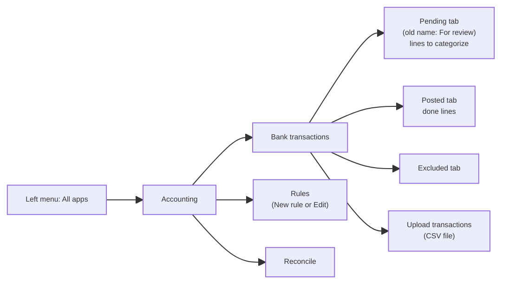

# QBO map card

> My own map of QuickBooks Online screens. Add a line each time I find a screen.
> Screenshots: sandbox only, crop out the top-right corner (login email). Save in `learning/cards/img/`.
> Tip: try the QBO search box before clicking menus.
> Related: [[qbo-sandbox]]

## Bank lines (Transactions)

| I want to...             | Click path                                                                   | Found      |
| ------------------------ | ---------------------------------------------------------------------------- | ---------- |
| Categorize bank lines    | All apps → Accounting → Bank transactions → **Pending** tab                  | 2026-10-29 |
| Undo a posted line       | All apps → Accounting → Bank transactions → Posted → Action → Undo           | 2026-10-29 |
| Make or edit a bank rule | All apps → Accounting → Rules → New rule (make new rule) or Edit (edit rule) | 2026-10-29 |
| Reconcile a bank account | All apps → Accounting → Reconcile                                            | 2026-11-08 |

## Screenshots

<!-- Paste a screenshot in Obsidian with Ctrl+V. It will show like this: ![[pending-tab.png]] -->